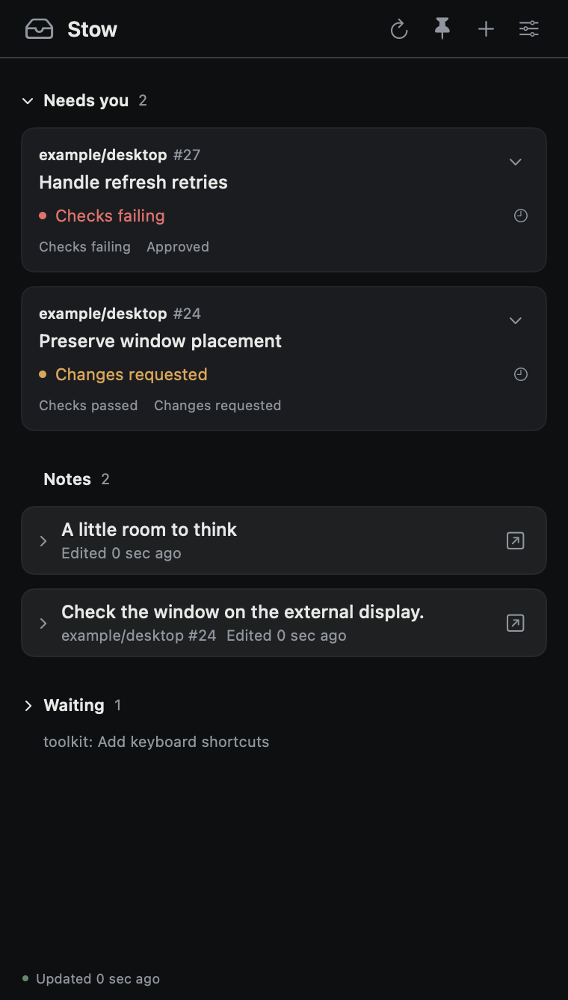
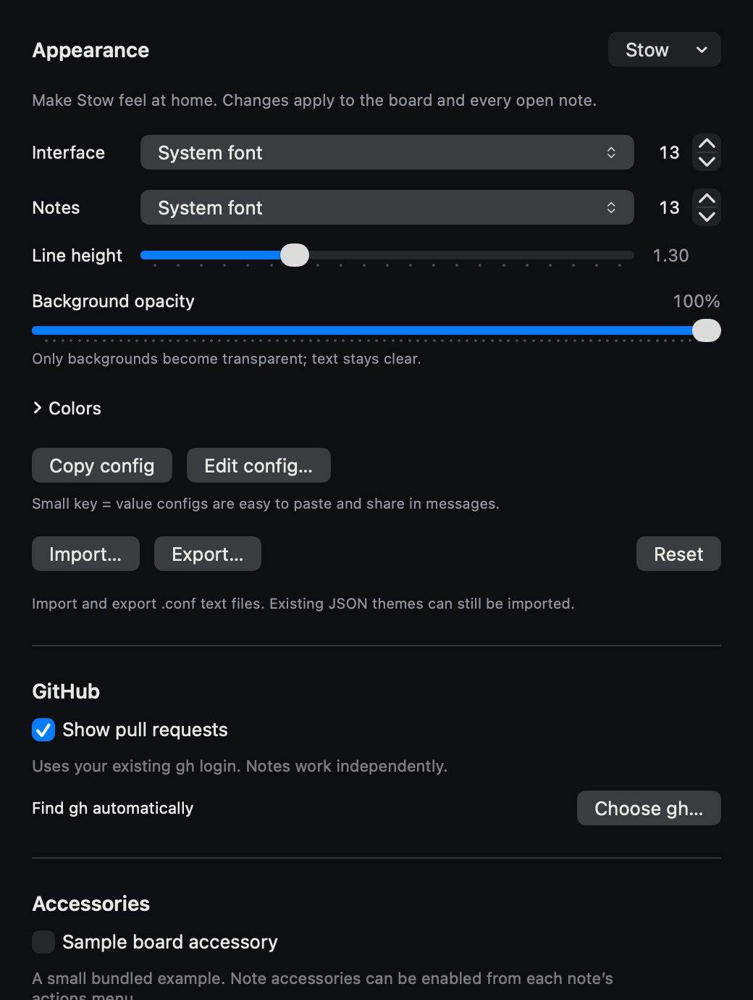

# stow

A small native macOS board for Markdown notes and GitHub pull requests. Requires macOS 14 or later.

Keep notes on the board or detach them into separate windows. Each detached note has its own always-on-top setting. Closing a note window keeps the note; deleting it is explicit. The board groups pull requests into “Needs you” and “Waiting” using observed GitHub state, and keeps cached cards when a refresh is incomplete.

GitHub is optional. Notes work without `gh`, an account, or a network connection. Accessories are optional too: the bundled `org.stow.sample` provider is disabled by default.



*Synthetic demo data; no personal notes or private repositories.*

## appearance

Choose a light or dark preset, adjust colors and background opacity, and set separate interface and note fonts, sizes, and note line height. Changes apply to the board and open notes. Copy, paste, edit, or share a short plaintext theme config. Import and export use `.conf`; existing JSON themes remain readable. See [appearance and themes](docs/appearance.md).

```ini
preset = graphite
font-family = Menlo
font-size = 14
background-opacity = 0.85
```



*Appearance settings from the synthetic demo session.*

## build

Use Xcode 16.4 or later with its command line tools selected. Open the checked-in project:

```sh
open Stow.xcodeproj
```

Choose the **Stow** scheme and run. Xcode downloads the pinned MarkdownUI dependency on the first build. XcodeGen is only needed when changing `project.yml`; project generation is not a setup prerequisite.

From the repository root:

```sh
./scripts/test.sh
./scripts/build.sh Debug
./scripts/package.sh
```

The scripts put their output in `build/`. Pass another directory as the second build argument or the first test/package argument, for example `./scripts/package.sh build/local`. Packaging builds a universal Release app for Apple silicon and Intel, signs it ad hoc for local use, and writes `Stow.zip` and its SHA256 checksum. This is a development package; Developer ID distribution and notarization are not configured.

## use

For a local package, unzip `Stow.zip` and move `Stow.app` to Applications. See [installation](docs/install.md).

- Create a note with **Command-N**. Switch between editing and Markdown preview from the note controls.
- Paste a canonical `https://github.com/example/project/pull/42` URL outside the editor to pin a pull request. Text following one URL becomes an attached note. Other or ambiguous text stays intact as a note.
- Detach a note from its actions menu. Use **Command-0** or the Dock icon to reopen the board.
- Click **Needs you**, **Waiting**, or **Notes** to collapse or expand that section. Stow remembers the choice; creating a note expands Notes again.
- Enable or disable GitHub in Settings. Install [GitHub CLI](https://cli.github.com/) and authenticate outside Stow with `gh auth login --hostname github.com`. Stow uses that existing login; it does not extract or save a token. Use **Choose gh…** if automatic discovery fails.
- Click a pull request to load details. Stow reads GitHub state; it does not merge, review, or modify pull requests.

## development

The Swift package tests the core, GitHub transport, and accessory contract independently of the app. `scripts/test.sh` also runs the hosted app tests using local ad-hoc signing and an isolated test host. The app uses AppKit windows, SwiftUI views, and a native text editor.

Read [architecture](docs/architecture.md), [appearance](docs/appearance.md), [accessory providers](docs/providers.md), [privacy and recovery](docs/privacy.md), and the [verification checklist](docs/verification.md). Feature acceptance, macOS 14 behavior, and performance claims require recorded validation; see that checklist for current evidence.

See the [roadmap](docs/roadmap.md) for the ordered release, public-site, and extension queue.

No project license has been selected. Third-party dependencies retain their own licenses.
